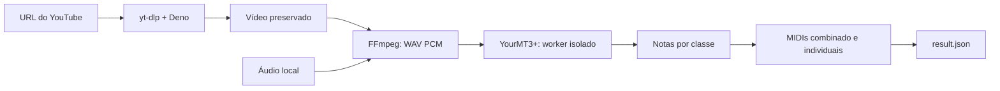

# YouTube MIDI

Transcrição musical de vídeos do YouTube ou arquivos de áudio locais para MIDI,
com uma faixa por classe de instrumento reconhecida e um arquivo combinado.

A CLI Python baixa um vídeo com imagem e áudio, extrai WAV, executa o YourMT3+
e exporta eventos musicais para estudo, análise e edição em uma DAW. O vídeo
original é preservado quando a entrada é uma URL. **Não é um separador de
stems:** a saída é MIDI, não áudio separado por instrumento.

**Estado:** fluxo implementado, com inferência real verificada em CPU e GPU
NVIDIA, inclusive via Docker. A precisão em músicas reais/densas ainda não foi
avaliada formalmente. O download YouTube foi testado com simulações, não com um
vídeo real; não se considera essa integração validada em produção.

## Sumário

- [Funcionalidades e arquitetura](#funcionalidades-e-arquitetura)
- [Requisitos](#requisitos)
- [Início rápido com Docker](#início-rápido-com-docker)
- [Exemplos de uso com Docker](#exemplos-de-uso-com-docker)
- [Execução local](#execução-local)
- [Comandos e configuração](#comandos-e-configuração)
- [Resultados](#resultados)
- [Modelo e memória GPU](#modelo-e-memória-gpu)
- [Diagnóstico](#diagnóstico)
- [Limitações e validação](#limitações-e-validação)
- [Desenvolvimento](#desenvolvimento)
- [Direitos e licenças](#direitos-e-licenças)
- [Documentação](#documentação)

## Funcionalidades e arquitetura

- Entrada por URL de um vídeo público ou arquivo local com áudio.
- Download com imagem e áudio, limites e validação de metadados.
- Extração WAV PCM via FFmpeg, preservando canais e taxa de amostragem nesta etapa.
- YourMT3+ T5 com notas simultâneas, classes de instrumentos e bateria.
- MIDI combinado e arquivos individuais por classe reconhecida, não por stem.
- Relatório JSON com estado do job, dispositivo, arquivos, instrumentos e avisos.
- Ambiente ML isolado, com dependências, fonte e checkpoint fixados.
- Execução CPU/CUDA local ou Docker não-root, com dados persistentes.
- Liberação automática do modelo da GPU e suporte a workers externos confiáveis.



A CLI invoca um subprocesso no ambiente Python do modelo. O worker adapta o
áudio para mono/16 kHz, processa segmentos em lotes e junta eventos nas fronteiras.
A exportação preserva timestamps e separa bateria de instrumentos tonais.
O modelo não fica residente entre conversões.

`prepare` encerra depois da extração WAV. `convert` verifica o backend antes
de baixar/preparar a mídia e executa o fluxo completo.

## Requisitos

Ambiente validado: Linux x86_64, nativo ou Ubuntu no WSL2. O container é Linux
amd64. O runtime ML fixado não foi certificado para ARM, macOS ou Python nativo
no Windows.

| Requisito | Execução local | Docker |
| --- | --- | --- |
| Python 3.11 e uv 0.9.30 | No host; uv gerencia os ambientes | Incluídos na imagem |
| FFmpeg e ffprobe | Executáveis no `PATH` | Incluídos na imagem |
| Deno | No `PATH`, para JavaScript do YouTube/yt-dlp | Deno 2.9.8 incluído |
| Docker e Compose | Não necessários | Instalados no host |
| NVIDIA, opcional | Driver compatível com CUDA 12.4 | Driver e acesso GPU pelo Docker |
| Internet | Setup inicial e download YouTube | Build/setup inicial e download YouTube |

CPU não exige GPU. Ambos os modos instalam PyTorch/torchaudio 2.5.1+cu124;
não é necessário instalar o CUDA Toolkit completo. Não substitua o Python do
sistema nem instale ML na `.venv` da CLI. Deno não participa da transcrição/CUDA.

Imagem Docker medida: cerca de **788 MiB descomprimidos**, com Python 3.11.18
slim-trixie, a menor entre as duas bases glibc testadas. O volume do modelo
ocupa cerca de **6,1 GiB adicionais**, inclusive em CPU. Reserve ao menos
12 GiB livres para setup, além de imagem, caches de build e mídias.

Tutoriais por pré-requisito: [docs/installation.md](docs/installation.md).
Docker Engine/Desktop, WSL2, Toolkit NVIDIA e permissões:
[docs/docker.md](docs/docker.md).

## Início rápido com Docker

Execute na raiz do repositório, pelo terminal Linux/WSL. Docker e Compose
devem estar funcionando; GPU também exige o acesso NVIDIA configurado no host.
Substitua `<ID_DO_VIDEO>` por um vídeo acessível e autorizado.

### GPU NVIDIA

```bash
mkdir -p output
export LOCAL_UID="$(id -u)" LOCAL_GID="$(id -g)"
docker compose build cpu
docker compose run --rm gpu setup-model --device cuda
docker compose run --rm gpu doctor --json
docker compose run --rm gpu convert 'https://www.youtube.com/watch?v=<ID_DO_VIDEO>' --device cuda
```

O build de `cpu` gera a imagem compartilhada pelos dois serviços. Execute
`setup-model` uma vez; nas próximas conversões, reutilize o volume.

### CPU, sem GPU

Após o mesmo build, use o serviço `cpu` e o dispositivo `cpu`:

```bash
docker compose run --rm cpu setup-model --device cpu
docker compose run --rm cpu convert 'https://www.youtube.com/watch?v=<ID_DO_VIDEO>' --device cpu --batch-size 1
```

Não é necessário instalar outro modelo para alternar CPU/GPU.

### Arquivo local

Com imagem e modelo já preparados:

```bash
export YT_MIDI_INPUT_DIR="/caminho/absoluto/da/pasta-com-audio"
docker compose run --rm gpu convert --audio-file '/input/musica.wav' --device cuda
```

Para CPU, troque `gpu` por `cpu` e `--device cuda` por `--device cpu`.
A pasta de entrada precisa existir e é montada somente para leitura.
Sem `YT_MIDI_INPUT_DIR`, `output` também fica acessível em `/input`.

Saídas ficam em `output/job-<id>/` no host; modelos no volume
`youtube-midi-models`, em `/models/yourmt3` no container. `--rm` remove o
container, não esses dados. **Não use `docker compose down -v` para limpeza
rotineira:** isso apaga o runtime e os pesos.

Comandos `docker run`, inferência sem rede e manutenção de UID/GID:
[docs/docker.md](docs/docker.md).

## Exemplos de uso com Docker

Execute os exemplos na raiz do repositório, depois do build e do `setup-model`
do [início rápido](#início-rápido-com-docker). Mantenha `output` criada e os
valores de `LOCAL_UID`/`LOCAL_GID` usados no build. Substitua os caminhos e IDs
pelos seus; as pastas e os arquivos de entrada precisam existir.

### Áudio local em CPU, inclusive com espaços no nome

```bash
export YT_MIDI_INPUT_DIR="/caminho/absoluto/da/pasta-com-audio"
docker compose run --rm cpu convert \
  --audio-file '/input/minha musica.wav' --device cpu --batch-size 1
```

A pasta do host é montada em `/input` somente para leitura. Os MIDIs e o
relatório ficam em `output/job-<id>/`, sem alterar o áudio original.

### YouTube em GPU, preservando os intermediários

```bash
docker compose run --rm gpu convert \
  'https://www.youtube.com/watch?v=<ID_DO_VIDEO>' \
  --device cuda --batch-size 1 --max-duration 1800 --keep-intermediates
```

Esse exemplo aceita vídeos de até 30 minutos e preserva `audio.wav` e
`transcription/` para inspeção. O limite rejeita vídeos mais longos; não os corta.
O lote menor reduz a pressão de VRAM.

### Preparar o WAV e transcrever em etapas separadas

```bash
docker compose run --rm cpu prepare 'https://www.youtube.com/watch?v=<ID_DO_VIDEO>'
docker compose run --rm gpu convert \
  --audio-file '/data/output/job-<id>/audio.wav' --device cuda
```

`prepare` não exige modelo e informa o caminho de `result.json`. Substitua
`job-<id>` pelo job criado nessa etapa; o WAV fica na mesma pasta do relatório.
`convert` exige o modelo preparado e cria outro job, preservando o WAV de entrada.
Para transcrever em CPU, use `cpu` e `--device cpu --batch-size 1`.

### Converter áudio local sem rede, com `docker run`

Depois de instalar o modelo no volume compartilhado, é possível executar a
inferência sem acesso à rede:

```bash
export YT_MIDI_INPUT_DIR="/caminho/absoluto/da/pasta-com-audio"
docker run --rm --init --network none \
  --mount type=volume,src=youtube-midi-models,dst=/models \
  --mount "type=bind,src=$PWD/output,dst=/data/output" \
  --mount "type=bind,src=$YT_MIDI_INPUT_DIR,dst=/input,readonly" \
  youtube-midi:local convert --audio-file '/input/minha musica.wav' \
  --device cpu --batch-size 1
```

Para GPU, acrescente `--gpus all` às opções de `docker run` e troque
`--device cpu` por `--device cuda`. `--network none` serve para áudio local;
downloads do YouTube e o primeiro setup continuam exigindo internet.

## Execução local

Depois de instalar uv/Python, FFmpeg e Deno, na raiz do repositório:

```bash
uv sync --locked --no-dev
uv run --no-dev yt-midi --help
uv run --no-dev yt-midi setup-model --device cuda
uv run --no-dev yt-midi doctor --json
uv run --no-dev yt-midi convert 'https://www.youtube.com/watch?v=<ID_DO_VIDEO>' --device cuda
```

Para CPU, use `--device cpu` no setup e nas conversões. `--no-dev` dispensa
ferramentas de desenvolvimento; não é necessário ativar um virtualenv.

```bash
uv run --no-dev yt-midi convert --audio-file /caminho/musica.wav --device cpu --batch-size 1
uv run --no-dev yt-midi prepare 'https://www.youtube.com/watch?v=<ID_DO_VIDEO>'
uv run --no-dev yt-midi prepare --audio-file /caminho/musica.wav --output-dir output
```

`prepare` não exige modelo e preserva o WAV. Para etapas separadas, use esse
WAV como `--audio-file` de uma nova conversão; isso cria outro job.

## Comandos e configuração

| Comando | Finalidade |
| --- | --- |
| `yt-midi --help` / `yt-midi --version` | Mostrar comandos / versão |
| `yt-midi doctor --json` | Mostrar ferramentas, manifesto do modelo e driver |
| `yt-midi setup-model --device cuda` | Instalar/verificar assets e executar inferência de verificação |
| `yt-midi prepare <URL>` | Baixar vídeo e extrair WAV, sem transcrição |
| `yt-midi convert <URL>` | Gerar MIDIs pelo backend instalado |
| `yt-midi convert --audio-file <arquivo>` | Converter mídia local, sem download YouTube |

Use o prefixo `uv run --no-dev` localmente, ou `docker compose run --rm <cpu|gpu>`
no container. URL e `--audio-file` são entradas alternativas, não simultâneas.

| Opção | Padrão da CLI | Uso |
| --- | --- | --- |
| `--output-dir` | `output` | Diretório pai dos jobs |
| `--max-duration` | `prepare`: 900 s; `convert`: 3600 s | Limite de duração aceito |
| `--max-download-size` | 1073741824 bytes, 1 GiB | Limite do download, não do WAV/MIDI |
| `--device` | `auto` | Em setup/convert: `auto`, `cpu` ou `cuda` |
| `--batch-size` | 4 | Lotes de segmentos na inferência; 1 reduz pressão de VRAM |
| `--bpm` | 120 | Tempo nominal do MIDI, não BPM estimado |
| `--keep-intermediates` | Desativado | Em convert: preservar WAV e dados intermediários |

Para permitir até duas horas, por exemplo:

```bash
uv run --no-dev yt-midi convert 'https://www.youtube.com/watch?v=<ID_DO_VIDEO>' --device cuda --max-duration 7200
```

Confira restrições com `yt-midi prepare --help` e `yt-midi convert --help`.
No Docker, use caminhos montados, como `/input/musica.wav` e `/data/output`.

O worker tem timeout fixo de 3600 segundos de execução, sem opção correspondente
na CLI. Ele é independente de `--max-duration`, que limita a duração da mídia.
Permitir uma entrada maior não aumenta o tempo disponível para transcrevê-la;
conversões longas, especialmente em CPU, podem terminar por timeout.

## Resultados

Cada execução cria um job exclusivo, sem sobrescrever a entrada. Uma conversão
bem-sucedida com entrada YouTube pode gerar esta estrutura ilustrativa:

```text
output/
  job-<id>/
    video/
    midi/
      combined.mid
      001_<instrumento>.mid
      002_<instrumento>.mid
    result.json
    worker.log
```

Os nomes dependem das classes reconhecidas; o vídeo pode ser MKV, MP4 ou WebM.

| Artefato | Comportamento |
| --- | --- |
| Vídeo original | Preservado quando a entrada é URL |
| `midi/combined.mid` | Faixas tonais e bateria, quando os canais permitem |
| MIDIs individuais | Um por classe reconhecida, não por fonte sonora física |
| `result.json` | Estado, opções, mídia, backend/checkpoint, dispositivo, instrumentos e avisos |
| `worker.log` | Saída e diagnósticos do worker, quando ele é iniciado |
| `audio.wav` e `transcription/` | Removidos após convert, inclusive em falhas de transcrição, salvo `--keep-intermediates` |

`prepare` preserva WAV e relatório, sem produzir MIDI. Uma conversão concluída
usa `status: completed`; falhas usam `failed`, interrupções tratadas usam
`cancelled`. Erros no preflight podem impedir a criação do job, portanto nem
todo erro produz relatório.

Abra os MIDIs em uma DAW, editor de partitura ou sintetizador MIDI e confira as
notas. Os timbres dependem do sintetizador/soundfont, não do áudio original.
Com mais de 15 classes tonais, os individuais permanecem, `midi.combined` é nulo
e o relatório registra um aviso, evitando reutilização silenciosa de canais.

No Docker, caminhos absolutos do JSON referem-se ao container:
`/data/output/...` corresponde a `output/...` no host.

## Modelo e memória GPU

YourMT3+ T5 usa a tarefa `mt3_full_plus`, com fonte e checkpoint de uma revisão
fixa do Space `mimbres/YourMT3`. O setup verifica SHA-256, carrega os pesos
estritamente e executa inferência antes de declarar o modelo pronto.
Fonte, checkpoint e evidências: [docs/model-evaluation.md](docs/model-evaluation.md).

O cache local usa `$XDG_CACHE_HOME/youtube-midi/yourmt3`, ou
`~/.cache/youtube-midi/yourmt3`. Para mudar de local, mantenha a mesma variável
no setup e nas conversões:

```bash
export YT_MIDI_MODEL_DIR="$HOME/modelos/youtube-midi"
uv run --no-dev yt-midi setup-model --device cpu
uv run --no-dev yt-midi convert --audio-file /caminho/musica.wav --device cpu
```

Não se instala um pacote pip chamado `yourmt3` nem se mistura o lock ML com a
CLI. Áudio local pode ser transcrito sem rede depois do setup; baixar vídeos
continua exigindo internet.

`auto` escolhe CUDA quando disponível, senão CPU. CUDA explicitamente solicitada
nunca é substituída silenciosamente por CPU. Na finalização normal e em exceções
Python dentro do worker, o modelo volta para CPU, o coletor de lixo roda e o
cache CUDA livre é liberado. O contexto CUDA remanescente termina com o processo;
os pesos persistentes e outras aplicações não são afetados.

No cancelamento da CLI ou timeout, o supervisor envia `SIGTERM` ao grupo do
worker e pode usar `SIGKILL` após 3 segundos. Atualmente esses sinais não
executam o `finally` Python do worker: a liberação nesses casos depende do
encerramento do processo, não da rotina explícita de limpeza.

### Worker personalizado

Um worker externo deve implementar [docs/worker-contract.md](docs/worker-contract.md):

```bash
uv run --no-dev yt-midi convert --audio-file /caminho/musica.wav \
  --worker /caminho/worker.py \
  --worker-python /caminho/ambiente-modelo/bin/python \
  --device cuda --batch-size 4 --keep-intermediates
```

`--worker-python` exige `--worker`. Execute apenas código e pesos confiáveis.
A disponibilidade/limpeza GPU de workers externos depende de sua implementação;
as garantias do backend integrado não se estendem a eles.

## Diagnóstico

Comece por `doctor --json`, pelo erro no terminal e por `result.json`/
`worker.log`, quando existirem. `doctor` não importa ML nem testa CUDA atual:
mostra o último dispositivo validado no setup. `convert` verifica a disponibilidade
atual antes de baixar/preparar a mídia.

| Sintoma | Ação |
| --- | --- |
| FFmpeg/ffprobe/Deno ausentes | Instalar executáveis e conferir `PATH` ou imagem usada |
| Modelo ausente/inválido | Executar setup-model com o mesmo cache/volume; não ignorar hashes |
| CUDA indisponível | Conferir driver; no Docker usar serviço gpu ou `--gpus all` |
| VRAM esgotada | Usar `--batch-size 1`, fechar outras aplicações ou escolher CPU |
| Permission denied nos dados | Conferir output e UID/GID; não usar `chmod 777`/convert como root |
| Limites excedidos | Ajustar duração/tamanho explicitamente, conforme recursos disponíveis |
| Nenhuma nota detectada | Tentar trecho musical audível; transcrição vazia não é sucesso |
| YouTube indisponível/restrito | Escolher mídia pública autorizada; autenticação/lives/DRM não suportados |

Tutoriais: [docs/installation.md](docs/installation.md) e [docs/docker.md](docs/docker.md).
Códigos de saída: [CONTRIBUTING.md](CONTRIBUTING.md).

## Limitações e validação

- Classes são as do checkpoint; algumas agrupam famílias, não instrumentos específicos.
- Duas fontes do mesmo instrumento não necessariamente viram duas faixas.
  Há falsos positivos e omissões, inclusive na bateria e em misturas densas.
- MIDI não contém áudio/timbres originais; não há separação de stems.
- Não há estimativa de BPM, quantização automática ou dinâmica fiel certificada.
  Neste backend a velocidade padrão das notas é 100.
- Voz 100/101 é mapeada para Voice Oohs/Choir Aahs; bateria usa percussão MIDI,
  não um programa GM 128. Mais de 15 classes tonais impedem o arquivo combinado.
- Interface web, playlists, canais, lives, DRM e autenticação estão fora do escopo.
- Vídeos longos aumentam armazenamento/RAM; lote menor reduz VRAM, não o custo
  de manter segmentos em memória. O limite de uma hora não certifica desempenho nessa duração.

Evidências locais registradas em 2026-11-15:

| Superfície | Evidência | Limite |
| --- | --- | --- |
| CLI, contratos e pipeline | 103 testes rápidos; Ruff, mypy, build e hooks aprovados | Não medem qualidade musical |
| Modelo real | Acorde sintético de 12 s em CPU/CUDA e inferência CUDA de 180 s | Não representa música densa/anotada |
| Docker | Build, ferramentas, não-root, preparo e conversão CPU/CUDA/offline aprovados | Validação local, não todos os hosts |
| Liberação GPU | Parâmetros/buffers voltam para CPU antes do fim do worker | Contexto CUDA pode reter memória interna |
| YouTube | Validação e limites testados com simulações | Download real ainda não verificado |
| CI | Workflow Python e gate Docker configurados; gate Docker executado localmente | Execução remota não verificada |

Próximas verificações prioritárias: download real de vídeo autorizado, avaliação
musical com áudios anotados e métricas por classe, e recursos em músicas longas/densas.
São pendências de validação, não garantias de precisão. Não há F1 certificado.
Melhorias técnicas identificadas: encerramento gracioso por sinais e timeout do
worker configurável, com testes que exercitem cancelamento pelo supervisor.

## Desenvolvimento

Layout `src`, Python `>=3.11,<3.12`, empacotamento Hatchling. Dependências core:
[pyproject.toml](pyproject.toml) e [uv.lock](uv.lock). Lock ML com hashes:
[src/youtube_midi/assets/yourmt3-requirements.txt](src/youtube_midi/assets/yourmt3-requirements.txt).

| Local | Responsabilidade |
| --- | --- |
| [src/youtube_midi/cli.py](src/youtube_midi/cli.py) | Comandos e diagnóstico |
| [src/youtube_midi/pipeline.py](src/youtube_midi/pipeline.py) | Jobs, relatórios e intermediários |
| [src/youtube_midi/download.py](src/youtube_midi/download.py) | URLs, metadados e download |
| [src/youtube_midi/audio.py](src/youtube_midi/audio.py) | FFprobe e extração PCM |
| [src/youtube_midi/transcription.py](src/youtube_midi/transcription.py) | Contrato e execução de workers |
| [src/youtube_midi/yourmt3_worker.py](src/youtube_midi/yourmt3_worker.py) | Modelo e ciclo de vida GPU |
| [src/youtube_midi/midi.py](src/youtube_midi/midi.py) | Exportação de MIDIs |
| [Dockerfile](Dockerfile) e [compose.yaml](compose.yaml) | Imagem e execução CPU/GPU |

```bash
uv sync --locked --group dev
uv run ruff check .
uv run ruff format --check .
uv run mypy
uv run pytest -m 'not model and not network and not gpu' --cov=youtube_midi
uv run yt-midi --help
uv build
```

Testes reais opcionais, após preparar assets, sem downloads nos testes:

```bash
YT_MIDI_RUN_MODEL_TESTS=1 uv run pytest tests/test_yourmt3.py -m model
```

A suíte completa de modelos inclui GPU e exige CUDA. Para somente CPU, use
`-m 'model and not gpu'`. Instale hooks com `uv run pre-commit install`.
Regras e gates Docker: [CONTRIBUTING.md](CONTRIBUTING.md).
Não versione mídias, modelos, credenciais, caches ou resultados.

## Direitos e licenças

Baixe/processe apenas mídias autorizadas, respeitando direitos autorais, termos
do YouTube e licenças das ferramentas/modelos. O backend executa código de
terceiros e carrega checkpoint: use somente fontes confiáveis.

Licenças do Space, repositório upstream e checkpoint precisam ser analisadas
separadamente; uso comercial e redistribuição de pesos não estão certificados
por este projeto. Consulte [docs/model-evaluation.md](docs/model-evaluation.md).

Este repositório ainda não declara uma licença própria em arquivo LICENSE ou
nos metadados do pacote. Essa definição é pendente; não presuma permissão de
redistribuição apenas por ter acesso ao código.

## Documentação

- [docs/installation.md](docs/installation.md): instalação local por pré-requisito.
- [docs/docker.md](docs/docker.md): Docker/WSL2/GPU, mounts, persistência e permissões.
- [docs/architecture.md](docs/architecture.md): arquitetura e decisões técnicas.
- [docs/worker-contract.md](docs/worker-contract.md): integração de outros backends.
- [docs/model-evaluation.md](docs/model-evaluation.md): checkpoint e evidências musicais.
- [CONTRIBUTING.md](CONTRIBUTING.md): desenvolvimento, verificação e códigos de saída.
