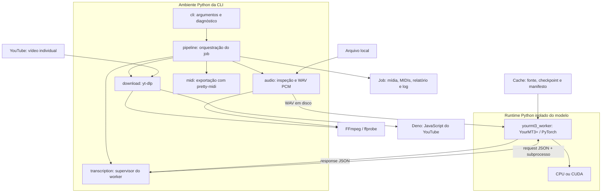
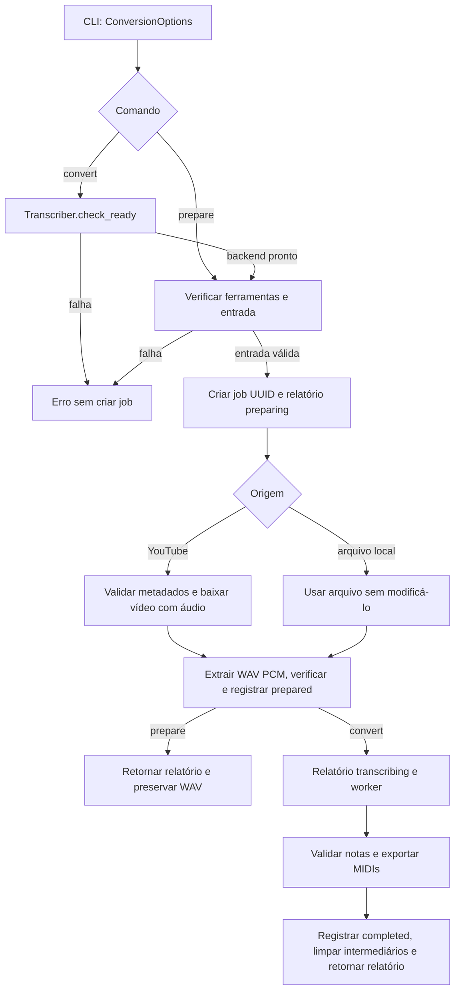
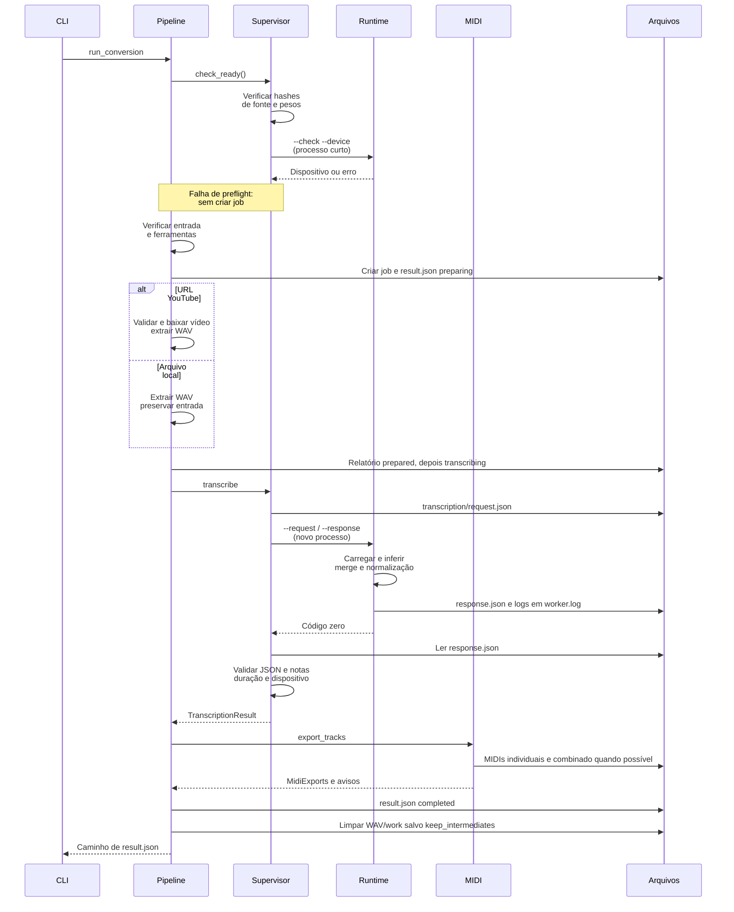
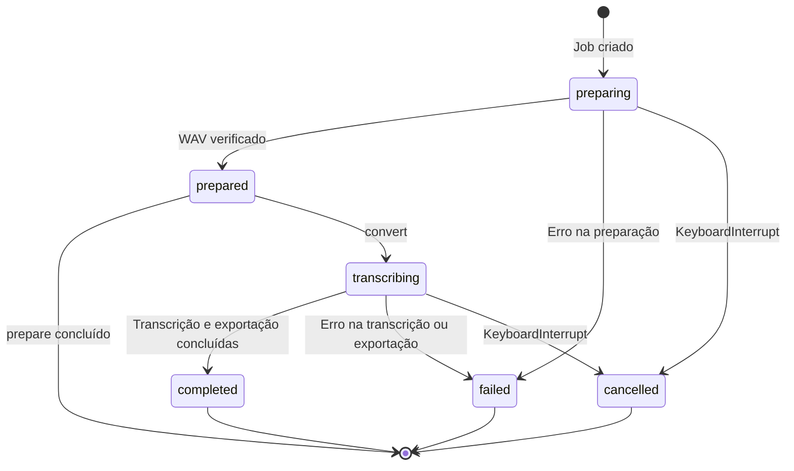
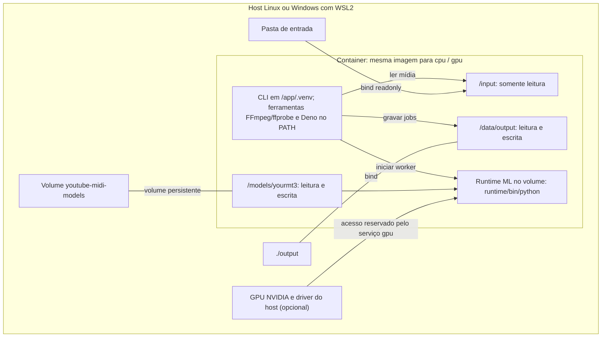

# Arquitetura

O YouTube MIDI é uma aplicação local de linha de comando. Cada execução prepara
uma única mídia e, opcionalmente, a transcreve em faixas MIDI por instrumento.
O pipeline é síncrono e sequencial por job: não há servidor, fila persistente,
agendamento ou retomada automática.

Esta página descreve a implementação atual e suas fronteiras. Comandos de uso
ficam no [README](../README.md); pré-requisitos e operação estão nos guias de
[instalação local](installation.md) e [Docker](docker.md).

## Sumário

- [Visão geral](#visão-geral)
- [Fluxo](#fluxo)
- [Responsabilidades](#responsabilidades)
- [Contratos de dados](#contratos-de-dados)
- [Ambiente do modelo](#ambiente-do-modelo)
- [Exportação MIDI](#exportação-midi)
- [Ciclo de vida do job](#ciclo-de-vida-do-job)
- [Implantação](#implantação)
- [Fronteiras de confiança](#fronteiras-de-confiança)
- [Estado da implementação](#estado-da-implementação)
- [Próximas entregas](#próximas-entregas)

## Visão geral

Há dois ambientes Python: o ambiente leve da CLI, com Typer, yt-dlp e
pretty-midi, e o runtime isolado do modelo, com PyTorch e suas dependências
fixadas. A CLI supervisiona o worker, mas não importa bibliotecas ML para
`--help` ou `doctor`. O modelo não é instalado no ambiente da CLI.

O WAV é compartilhado por caminho de arquivo; request e response transportam
metadados e eventos de notas, nunca tensores. Deno participa do download, não da
inferência. Cada conversão inicia seu próprio processo de inferência: não há
modelo residente compartilhado entre jobs.

As saídas são eventos MIDI, não stems de áudio. Uma faixa representa o programa
ou classe estimada pelo modelo, não necessariamente uma fonte sonora individual.
O MIDI não contém os timbres originais nem garante identificação instrumental
correta.

## Fluxo

### Preparação e conversão

O diagrama mostra o caminho de sucesso e as falhas anteriores ao job; falhas
durante o processamento são detalhadas no ciclo de vida abaixo. A ordem é
controlada por `prepare_media` e `run_conversion` em
[pipeline.py](../src/youtube_midi/pipeline.py). A limpeza final respeita
`--keep-intermediates`.

`prepare` termina na preparação de mídia. `convert` usa YourMT3+ por padrão:
verifica fonte/checkpoint por SHA-256 e disponibilidade do dispositivo no runtime
antes de criar saídas ou baixar vídeo. Workers externos continuam como override
explícito, com verificação apenas do script e interpretador.

As opções exigem exatamente uma URL ou um arquivo local. URLs são normalizadas
para um vídeo HTTPS do YouTube; playlists, canais, lives e conteúdo que exige
autenticação não são suportados. O download valida metadados antes de transferir,
limita duração e bytes, preserva vídeo com áudio e verifica a mídia concluída.
O arquivo local é inspecionado antes da criação do job e nunca é sobrescrito.

FFmpeg seleciona o primeiro stream de áudio e extrai WAV `pcm_s16le`, sem forçar
taxa de amostragem nem número de canais. A adaptação para mono/16 kHz ocorre
depois, no worker nativo. Por isso, o WAV intermediário pode continuar estéreo
e em 44,1 kHz, por exemplo.

### Sequência da conversão nativa

O processo curto de preflight verifica o dispositivo, não mantém um modelo
carregado para a inferência. O processo seguinte carrega seus próprios pesos.
O supervisor redireciona stdout e stderr desse processo para o log; a resposta
estruturada é lida do arquivo, não extraída de mensagens humanas.

## Responsabilidades

| Módulo | Interfaces principais | Responsabilidade |
| --- | --- | --- |
| [cli](../src/youtube_midi/cli.py) | `_options`, `_execute`, comandos Typer | Argumentos, progresso em stderr, resultado em stdout e códigos de saída |
| [models](../src/youtube_midi/models.py) | `ConversionOptions`, `MediaInfo`, `NoteEvent`, `InstrumentTrack` | Contratos imutáveis e validação de opções/eventos |
| [errors](../src/youtube_midi/errors.py) | `ProjectError` e erros por etapa | Categorias de falha e códigos de saída |
| [download](../src/youtube_midi/download.py) | `validate_youtube_url`, `download_video` | URL canônica, metadados, limites e vídeo com áudio via yt-dlp |
| [audio](../src/youtube_midi/audio.py) | `probe_media`, `extract_audio` | ffprobe JSON, FFmpeg e publicação do WAV PCM |
| [transcription](../src/youtube_midi/transcription.py) | `Transcriber`, `WorkerTranscriber`, `YourMT3Transcriber` | Preflight, subprocesso e validação da resposta JSON |
| [yourmt3](../src/youtube_midi/yourmt3.py) | `setup_model`, `validate_assets`, `normalize_notes` | Runtime, integridade dos assets e adaptação de notas sem importar ML |
| [yourmt3_worker](../src/youtube_midi/yourmt3_worker.py) | `install_assets`, `model_session`, `transcribe` | Carregamento YourMT3+, pré-processamento, inferência e merge |
| [midi](../src/youtube_midi/midi.py) | `export_tracks`, `MidiExports` | MIDIs individuais e combinado, sem inferir notas/instrumentos |
| [pipeline](../src/youtube_midi/pipeline.py) | `PreparedMedia`, `prepare_media`, `run_conversion` | Ordenação das etapas, jobs, relatórios e limpeza |

`Transcriber` é a fronteira de extensão: expõe `check_ready()` e
`transcribe(audio, directory, options)`. O pipeline depende desse protocolo,
não do carregamento do YourMT3+. O backend nativo reutiliza o supervisor de
processos e acrescenta seu preflight; `--worker` permite substituir explicitamente
o script, com `--worker-python` para escolher seu interpretador.

## Contratos de dados

As interfaces próprias usam dataclasses imutáveis. O JSON existe na fronteira
de processos e no relatório; o restante do pipeline usa objetos tipados.

| Contrato | Conteúdo e invariantes |
| --- | --- |
| `ConversionOptions` | Uma única origem, diretório de saída, dispositivo, lote, limites, retenção e BPM nominal; valores positivos e duração finita |
| `MediaInfo` | Caminho, duração em segundos, taxa em Hz e número de canais verificados por ffprobe |
| `PreparedMedia` | Diretório exclusivo do job, vídeo opcional, áudio preparado e metadados para o relatório |
| `NoteEvent` | `start`/`end` finitos em segundos, `start >= 0`, `end > start`, pitch inteiro 0..127 e velocity inteira 1..127 |
| `InstrumentTrack` | Nome não vazio, programa General MIDI inteiro 0..127, notas e booleano explícito `is_drum` |
| `TranscriptionResult` | Faixas, identidade do backend, dispositivo efetivo e avisos |
| `MidiExports` | Caminho opcional do combinado, caminhos individuais e avisos de exportação |

### Fronteira JSON do worker

O request tem `schema_version: 1`, metadados do áudio com caminho absoluto,
`device` e `batch_size`. O worker recebe os caminhos pelos argumentos `--request`
e `--response`; não recebe mídia por stdin. A resposta inclui a mesma versão,
`backend` com nome/revisão/SHA-256 do checkpoint, dispositivo efetivo, faixas e
avisos. Exemplos completos: [contrato do worker](worker-contract.md).

O supervisor exige término com código zero e resposta JSON legível de até
16 MiB. Valida os contratos das notas, nomes e programas, o hash declarado
com 64 dígitos hexadecimais e `device` igual a `cpu` ou `cuda`. Se o dispositivo
solicitado não for `auto`, a resposta deve informar exatamente o solicitado.
Notas que terminam mais de 100 ms além da duração do áudio são rejeitadas.

Essas verificações não provam a qualidade musical. Para workers personalizados,
a proveniência declarada é registrada, mas verificar os pesos e a fonte continua
sendo responsabilidade do backend. No nativo, a integridade também é verificada
antes da inferência. Uma resposta vazia não gera uma conversão MIDI bem-sucedida.

## Ambiente do modelo

### Instalação e integridade

`setup-model` é uma operação explícita, com acesso à rede, para Linux/WSL.
Ela não é disparada automaticamente por `convert`:

1. Cria ou reutiliza `runtime/`, um virtualenv Python 3.11 no cache do modelo.
2. Sincroniza as dependências do [lock ML](../src/youtube_midi/assets/yourmt3-requirements.txt)
    com `uv pip sync --require-hashes --torch-backend cu124`. O lock da CLI
    permanece separado; o mesmo runtime ML também executa em CPU.
3. Baixa somente os arquivos Python selecionados e o checkpoint de uma revisão
    fixa do Space `mimbres/YourMT3`, sem executar UI, OAuth ou treinamento.
4. Confere o SHA-256 do checkpoint, reconstrói a configuração T5 e carrega os
    pesos com `strict=True`, removendo as chaves de pitchshift não usadas.
5. Executa inferência de verificação no dispositivo selecionado e só então
    publica o manifesto com revisão, hashes da fonte e versões do runtime.

Fonte, revisão, checkpoint e limitações de licença estão registrados em
[avaliação do modelo](model-evaluation.md#backend-instalado).

| Local no cache do modelo | Papel |
| --- | --- |
| `runtime/bin/python` | Interpretador isolado usado pelo worker |
| `source/amt/src/` | Código de inferência da revisão fixada |
| `source/amt/logs/.../checkpoints/model.ckpt` | Pesos persistentes do modelo |
| `manifest.json` | Identidade e evidências da instalação concluída |

`YT_MIDI_MODEL_DIR` tem precedência sobre o caminho padrão. Sem essa variável,
usa-se `$XDG_CACHE_HOME/youtube-midi/yourmt3` ou
`~/.cache/youtube-midi/yourmt3`. Setup e conversão devem apontar para o mesmo
cache; esse diretório não é parte do job e não é apagado ao converter.

`doctor` inspeciona ferramentas e o estado instalado sem importar ML. A informação
de dispositivo no manifesto reflete a última validação do setup, não CUDA atual.
O preflight de `convert` confere hashes completos e executa `--check` no runtime,
com timeout de 30 segundos. O worker nativo também verifica os assets ao transcrever.

### Inferência e identificação instrumental

O processamento nativo segue estas etapas:

1. Carrega o WAV, faz a média dos canais e reamostra para mono/16 kHz.
2. Divide o áudio em segmentos de 32767 frames, cerca de 2,05 segundos, com
    padding no último segmento. Áudio e segmentos permanecem na RAM.
3. Processa segmentos em lotes sob `torch.inference_mode()`. `inference_file`
    transfere o lote para o dispositivo; `batch_size` limita esse trabalho na GPU.
4. Detokeniza usando timestamps absolutos de início dos segmentos e reutiliza
    o merge upstream de eventos e ties para reunir notas sustentadas.
5. Mistura as notas dos canais internos de decodificação e as normaliza em
    faixas por programa previsto e flag de percussão.

Reduzir o lote ajuda a limitar VRAM, mas não elimina o custo de manter os
segmentos e o áudio na RAM. A implementação não faz streaming de duração
arbitrária nem carrega somente uma janela de áudio por vez.

Nomes seguem `GM_INSTR_EXT_CLASS_PLUS`, o vocabulário agrupado do checkpoint.
Um grupo como Strings não é renomeado como violino sem evidência. Duas fontes
do mesmo programa podem compartilhar a faixa; canais de decodificação não são
identidades instrumentais. A continuidade usa o algoritmo upstream, mas ainda
precisa de avaliação musical, e erros de decode/merge viram avisos.

Notas fora da duração real por causa do padding final são descartadas ou têm
o final limitado. Outros eventos inválidos são descartados com aviso. A velocity
é fixa em 100, sem estimativa de dinâmica. Voz 100/101 usa programas GM 53/52;
bateria usa `is_drum=true` e programa 0, nunca o token interno 128 como programa GM.

### Dispositivo e memória

`auto` escolhe CUDA se disponível, senão CPU. CUDA explicitamente solicitada
exige disponibilidade e uma operação real no runtime; não há fallback silencioso
em falha de CUDA ou falta de VRAM. O usuário pode reduzir o lote ou escolher CPU.

`model_session` carrega o modelo em CPU e o move ao dispositivo escolhido.
Na finalização normal e em exceções Python que desenrolam esse contexto, seu
`finally` move o modelo para CPU, executa `gc.collect()` e, em CUDA, chama
`torch.cuda.empty_cache()`. O processo é temporário; os pesos em disco são
preservados. O contexto CUDA e alocações internas podem persistir até o fim do
processo: cache liberado não significa zero memória reportada pelo driver.
Encerramento por sinais é um caso distinto, descrito abaixo.

## Exportação MIDI

O exportador recebe notas já transcritas e não executa identificação adicional.
Faixas sem notas são omitidas com aviso; se nenhuma faixa tiver notas, a
exportação falha. No worker nativo, a ausência de notas já interrompe a transcrição.

Cada faixa ativa gera um arquivo numerado com nome sanitizado. `combined.mid`
é criado somente com até 15 faixas tonais, por causa do limite de canais MIDI
disponíveis além da percussão. Com mais faixas tonais, os individuais continuam
válidos, o combinado é ausente e `midi.combined` recebe `null`, acompanhado de aviso.

Tempos de notas continuam em segundos. `--bpm` define o tempo nominal do arquivo
e não detecta o BPM da música, quantiza notas nem reconstrói um mapa de andamento.
A exportação usa resolução de 960 ticks por semínima e preserva os eventos
recebidos; não recria áudio ou timbres originais.

## Ciclo de vida do job

### Estados persistidos

O diagrama representa os estados definidos no pipeline, não uma máquina de
retomada. Durante a exportação, o estado continua `transcribing`; não há estado
`exporting`. `prepare` bem-sucedido termina em `prepared`, e `convert` em
`completed`. Falhas antes da criação do job não têm relatório próprio.

Após a criação, erros tratados tentam registrar `failed`, ou `cancelled` para
`KeyboardInterrupt`, com a mensagem de erro. Falta de espaço/permissão pode
impedir a atualização. Um processo morto abruptamente pode deixar apenas o
último estado gravado; não se deve interpretá-lo como recuperação garantida.
Erros na limpeza final também podem ocorrer depois de gravar `completed`.

### Artefatos e retenção

Cada execução cria `job-<uuid>/` dentro do diretório de saída. A tabela descreve
uma execução bem-sucedida; em falhas podem existir somente artefatos parciais.

| Artefato no job | `prepare` | `convert` padrão | `convert --keep-intermediates` |
| --- | --- | --- | --- |
| `video/<id>.<ext>` | Preservado se origem YouTube | Preservado se origem YouTube | Preservado se origem YouTube |
| `audio.wav` | Preservado | Removido na limpeza final | Preservado |
| `transcription/request.json` | Não gerado | Removido na limpeza final | Preservado |
| `transcription/response.json` | Não gerado | Removido na limpeza final | Preservado |
| `worker.log` | Não gerado | Preservado | Preservado |
| `midi/NNN_<nome>.mid` | Não gerado | Preservado para cada faixa ativa | Preservado para cada faixa ativa |
| `midi/combined.mid` | Não gerado | Preservado quando possível | Preservado quando possível |
| `result.json` | Estado `prepared` | Estado `completed` | Estado `completed` |

A limpeza de `convert` fica no `finally` após a preparação bem-sucedida e
também ocorre em falhas de transcrição/exportação e cancelamento tratado.
Ela remove somente o WAV e o diretório `transcription/` do próprio job.
Vídeo, MIDIs, relatório e log, quando gerados, não são removidos por essa limpeza.
Falhas dentro de `prepare_media` ocorrem antes desse `finally`; não há promessa
de apagar todos os artefatos parciais de preparação. Entrada local e cache do
modelo nunca são alvos dessa rotina.

### Relatório e diagnóstico

`result.json` tem `schema_version: 1` e é atualizado ao longo do job:

| Campos | Quando aparecem e significado |
| --- | --- |
| `project_version`, `status`, `options` | Desde a preparação; opções registradas e URL normalizada quando aplicável |
| `video` | Origem YouTube baixada; identificação, título, duração e caminho |
| `audio` | Após extração; caminho e características do WAV preparado |
| `backend`, `device` | Conversão concluída; proveniência e dispositivo efetivo |
| `instruments` | Conversão concluída; nome, programa, percussão e contagem de notas por faixa retornada |
| `midi` | Conversão concluída; combinado opcional e lista de arquivos individuais |
| `warnings` | Conversão concluída; avisos da transcrição e exportação |
| `error` | Falha ou cancelamento tratado, se o relatório puder ser gravado |

O relatório registra os dados da etapa, não garante que cada caminho ainda
exista: `audio.path` pode apontar para o WAV removido na limpeza padrão. Uma
faixa retornada sem notas pode aparecer em `instruments` sem um MIDI individual.
Tempos por etapa ainda não estão estruturados nesse JSON; o worker registra
progresso, tempo de inferência e, em CUDA, pico alocado pelo PyTorch no log.

A CLI escreve progresso e erros em stderr, e o caminho do relatório de sucesso
em stdout. Use o relatório e `worker.log` quando disponíveis; para falhas de
preflight, comece pela mensagem da CLI e `doctor`. Os códigos distinguem
dependências, download, áudio, transcrição, MIDI, sistema de arquivos e
cancelamento: [tabela de códigos](../CONTRIBUTING.md#códigos-de-saída).

### Publicação e falhas de escrita

O diretório do job usa UUID e criação exclusiva. Downloads recusam colisões,
a extração não sobrescreve destinos e o exportador recusa um diretório MIDI
existente. Se a escrita MIDI falha dentro da exportação, seu diretório recém-criado
é removido, em vez de declarar um conjunto parcial como sucesso.

FFmpeg escreve em um temporário no mesmo sistema de arquivos; após verificar
a mídia, um hard link publica o WAV e recusa atomicamente um destino existente.
`result.partial.json` é substituído por `result.json` no mesmo diretório, evitando
que uma leitura veja o JSON parcialmente escrito na operação normal.

Essas garantias são locais: não há transação única para vídeo, WAV, MIDIs e
relatório, nem garantia de durabilidade por `fsync`. Interrupções abruptas podem
deixar temporários. UUIDs evitam colisões de jobs, mas não implementam bloqueio
ou coordenação de instalações concorrentes no cache compartilhado do modelo.

### Timeout e cancelamento

O supervisor tem timeout de **3600 segundos de execução do worker**, sem flag
correspondente na CLI. Ele é independente de `--max-duration`, que limita a
duração da mídia. Aumentar o limite de áudio não aumenta o tempo permitido de
inferência; preparação, download e preflight não entram nesse timeout do worker.

Em Linux/POSIX, o processo inicia em uma sessão própria. Em timeout ou
`KeyboardInterrupt` no supervisor, `_stop_process` envia `SIGTERM` ao grupo,
espera até 3 segundos e pode enviar `SIGKILL`, aguardando o encerramento.
Timeout vira erro de transcrição; cancelamento tratado usa código de saída 130.

Esses sinais atualmente não executam o `finally` Python do worker. A liberação
de recursos nesse caminho depende do fim do processo, não da limpeza explícita
de `model_session`. Capturar `KeyboardInterrupt` dentro do worker em testes
não equivale a cancelar a CLI que supervisiona esse subprocesso.

## Implantação

CPU e GPU usam a mesma imagem `linux/amd64`, com Python 3.11, uv, FFmpeg/ffprobe,
Deno e o pacote da CLI instalado. PyTorch e pesos não entram na imagem: o setup
os instala no volume persistente. O container executa como usuário `app`, não-root.

O diagrama representa um container por execução, não dois serviços que trocam
mensagens. `cpu` e `gpu` são configurações de execução no
[Compose](../compose.yaml); `gpu` acrescenta acesso NVIDIA. A escolha explícita
`--device cpu` ou `--device cuda` continua necessária para garantir o dispositivo
desejado. O driver vem do host, não é instalado dentro da imagem.

| Aspecto | Execução local | Docker |
| --- | --- | --- |
| Ambiente da CLI | `.venv` do projeto ou instalação do pacote | `/app/.venv` na imagem |
| Modelo | Cache local ou `YT_MIDI_MODEL_DIR` | `/models/yourmt3` no volume persistente |
| Entrada local | Caminho acessível ao usuário | `/input`, bind somente leitura |
| Saída padrão | `output/` no diretório de execução | `/data/output`, bind de `./output` |
| GPU | Driver acessível ao runtime | Driver do host e acesso NVIDIA no container |

`YT_MIDI_INPUT_DIR` escolhe a pasta montada em `/input`; sem ela, a pasta `output`
também é montada ali somente para leitura. UID/GID configurados no build ajudam
a manter saídas com o dono esperado. Não monte a `.venv` ou o runtime do host
como ambiente do container: caminhos e bibliotecas são próprios de cada sistema.
Comandos, preparação de pastas e requisitos NVIDIA: [guia Docker](docker.md).

## Fronteiras de confiança

O isolamento do runtime reduz conflitos de dependências, não constitui uma
sandbox. Workers personalizados são scripts executados com as permissões do
usuário. O checkpoint nativo usa `torch.load(..., weights_only=False)`, cuja
desserialização pode executar código; fonte, pesos e revisão precisam ser
confiáveis. Hashes conferem integridade, não certificam segurança, qualidade ou
direitos de redistribuição.

A inferência é configurada com `HF_HUB_OFFLINE=1`, `TRANSFORMERS_OFFLINE=1` e
`WANDB_MODE=disabled`. O contrato exige que o worker não faça downloads nem use
outros serviços de rede. Essas variáveis controlam bibliotecas específicas:
não bloqueiam sockets nem impedem scripts externos de acessar a rede.

Áudio local pode ser convertido offline depois do setup. Para impor ausência de
rede ao container, há um exemplo com `--network none` no
[README](../README.md#converter-áudio-local-sem-rede-com-docker-run).
Baixar vídeo YouTube ou instalar o modelo continua exigindo rede. Processe
somente mídias autorizadas, respeitando direitos e termos da fonte.

## Estado da implementação

As evidências abaixo são registros de validações anteriores, não certificação
de qualquer áudio ou host. Detalhes musicais e medidas estão em
[avaliação do modelo](model-evaluation.md), e a visão consolidada no
[README](../README.md#limitações-e-validação).

| Superfície | Implementado e verificado | Limite da evidência |
| --- | --- | --- |
| CLI e pipeline | `prepare`, `convert`, `doctor`, `setup-model`; testes de contratos, fluxo e erros | Não medem acurácia musical |
| Download | Validação de URL, metadados e limites com simulações | Smoke test real YouTube pendente |
| Áudio | Extração e inspeção com FFmpeg local | Testes usam mídias sintéticas |
| Modelo e MIDI | Inferência real CPU/CUDA, normalização e exportação | Áudios sintéticos não representam misturas densas |
| Docker | Build, não-root, ferramentas, preparo e inferência CPU/CUDA/offline locais | Não certifica todos os hosts nem CI remota |
| Memória GPU | Limpeza explícita do modelo no caminho normal e em exceções Python | Sinais do supervisor dependem do encerramento do processo |

Não há F1 certificado, identificação perfeita de timbre, suporte garantido a
todos os 128 instrumentos GM ou separação de fontes iguais. Avaliação musical
permanece separada dos testes de software e da verificação de infraestrutura.

## Próximas entregas

Prioridades de validação e evolução, ainda não funcionalidades disponíveis:

1. Validar download real de um vídeo público autorizado.
2. Avaliar gravações autorizadas/anotadas por instrumento, incluindo bateria,
    continuidade de notas, F1/onsets/offsets e erros de classificação.
3. Medir RAM, VRAM e desempenho em músicas longas/densas, sem extrapolar dos
    resultados sintéticos ou confundir alocação PyTorch com VRAM total.
4. Incluir tempos por etapa no relatório e tornar o timeout do worker configurável.
5. Implementar encerramento gracioso por sinais, com testes de cancelamento
    exercitando a CLI supervisora e não somente exceções internas do worker.

Se YourMT3+ não atender aos critérios musicais, avaliar MT3 separadamente.
Não criar dois backends sem necessidade nem reduzir o requisito de identificação
instrumental a stems genéricos. Interface web, filas, playlists e autenticação
não fazem parte da arquitetura atual.
